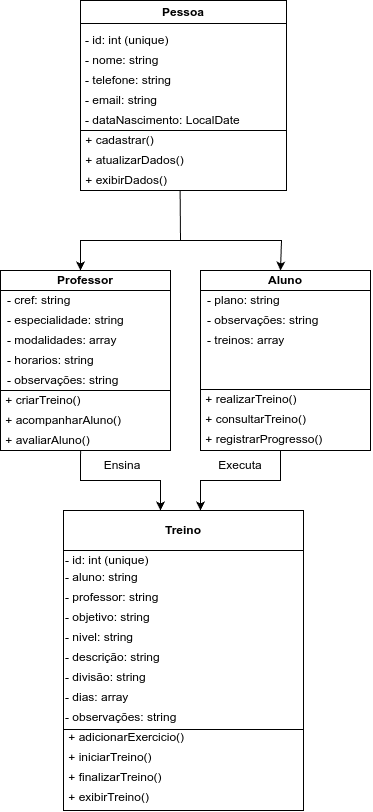

# AcademiaFacil

Sistema para gerenciamento de uma academia, permitindo cadastrar professores e alunos, além de criar e acompanhar treinos personalizados.

Entidades

O sistema possui três classes principais, conforme o diagrama de classes:

Professor: armazena os dados dos professores e permite criar treinos, acompanhar alunos e avaliar seu progresso.
Aluno: armazena os dados dos alunos e permite consultar treinos, realizar exercícios e registrar o progresso.
Treino: representa os treinos dos alunos, contendo informações como objetivo, nível, descrição, divisão, dias e observações.

A classe Pessoa representa os dados comuns de professores e alunos, como nome, telefone, e-mail e data de nascimento.

Tecnologias utilizadas
JSP (JavaServer Pages): criação das páginas web do sistema.
Gson: conversão de objetos Java para JSON e vice-versa.
JSON: formato utilizado para representar e trocar dados.
Apache Tomcat: servidor responsável por executar a aplicação web.
Diagrama de classes

O diagrama apresenta as classes Pessoa, Professor, Aluno e Treino, seus atributos, métodos e relacionamentos.

Como rodar o projeto
Instale os pré-requisitos: Java JDK, Eclipse IDE e Apache Tomcat.
Abra o Eclipse: importe o projeto existente pelo menu File > Import > General > Existing Projects into Workspace.
Configure o Tomcat: acesse a aba Servers, adicione o servidor Apache Tomcat e configure sua instalação.
Configure as dependências: adicione a biblioteca Gson ao projeto, caso ainda não esteja configurada.
Execute o projeto: clique com o botão direito no projeto e selecione Run As > Run on Server.
Acesse o sistema: abra no navegador o endereço local indicado pelo Eclipse após a inicialização do servidor.
Observação: os passos podem variar conforme a estrutura do projeto e a versão do Eclipse. O projeto precisa estar configurado como uma aplicação web Java compatível com o Tomcat para ser executado dessa forma.